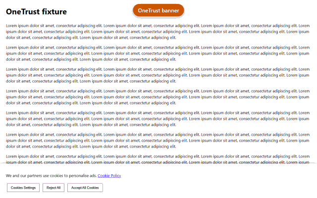

<p align="center"></p>

<h3 align="center">oho (Tamazight for "no")</h3>

<p align="center">Auto-rejects cookie banners. Tiny, fast, private.</p>

<p align="center"></p>

oho is a Manifest V3 browser extension for Chrome and Firefox. It **rejects** cookie consent banners
instead of just hiding them:
- where a site offers "Reject all", oho clicks it;
- where refusing takes several steps, oho opens the preferences, switches every non-essential
  purpose off, and saves;
- where there is no way to refuse at all, oho hides the notice and gives you your scroll back.

It never clicks anything that reads as "accept", and never anything that leads to paying.
Pay-or-accept walls are left alone unless you choose to hide them.

- **18.2 KB** zipped for Chrome (18.6 KB for Firefox), with zero runtime dependencies: no
  frameworks, no ML runtimes, no WASM.
- **No network requests, no analytics, no data collection.** Everything runs locally
  ([privacy policy](PRIVACY.md)).
- **1.2–7.5 ms** median main-thread work per page on the test fixtures, at most 9.6 ms, against a
  10 ms budget. It never blocks page load.
- **Live, from a non-EU location** (52 sites, a banner shown on 38): **38 of 38 banners handled correctly**.
  31 were rejected (29 of them verified in the CMP's own storage), 1 notice was hidden, and 6
  pay-or-accept walls were left alone. **0 accept clicks**, 0 failed. 5 sites missed in the parallel
  pass and were retried alone: 4 were then handled, and 1 never showed its banner.
- **Live, from the EU:** not run yet. It needs an EU proxy:
  `node tests/live/run.ts --proxy <url> --concurrency 1` writes `tests/live/report-eu.md`.

## Install

```sh
npm install
npm run build        # -> oho-chrome.zip, oho-firefox.zip (+ unpacked in dist/chrome, dist/firefox)
```

- **Chrome / Edge / Brave:** open `chrome://extensions`, enable *Developer mode*, then *Load unpacked*
  and pick `dist/chrome`. You can also upload `oho-chrome.zip` to the Chrome Web Store.
- **Firefox (140+):** `npm run firefox` builds and launches Firefox with oho loaded (needs Firefox
  installed). Or open `about:debugging#/runtime/this-firefox`, choose *Load Temporary Add-on*, and
  pick `dist/firefox/manifest.json`. To publish, sign `oho-firefox.zip` through AMO.
  `npm run lint:firefox` runs `web-ext lint` (0 errors, 0 warnings). Firefox lets users withhold
  MV3 site access; if it is missing, the popup shows a **Grant access** button.

The popup has:
- a global on/off switch;
- a *Disable on this site* switch;
- a *Hide pay-or-accept walls* switch, off by default;
- a line saying what happened on the current page, for example "Pay-or-accept wall: no free way to
  refuse";
- two counters: banners handled on this tab, and the total.

The switches are kept in `chrome.storage.local` as `oho_settings`.

## How it works

The content script runs at `document_idle` and does the following, in this order:

1. **Rule engine (fast path).** It checks for known CMPs (OneTrust, Cookiebot, Didomi,
   Quantcast/InMobi Choice, TrustArc, Usercentrics, Sourcepoint, Axeptio, Iubenda, Complianz).
   Detect selectors are pre-split at startup: `#id` selectors use `getElementById`, `.class`
   selectors use `getElementsByClassName`, and `body > x` selectors scan only the body's children.
   On a page with no CMP, the check costs a few O(1) lookups. For a matched CMP, oho tries:
   1. a visible **reject button**. oho then **confirms the banner closed** and clicks again if it
      didn't: live CMPs often render the button before its click handler is attached;
   2. the CMP's own **JS reject API** (for example `Didomi.setUserDisagreeToAll()`), called through a
      tiny MAIN-world bridge (`src/api.ts`) that holds a fixed map of reject functions. Every function
      in it was confirmed to exist on live sites;
   3. a **multi-step flow**: open preferences → uncheck everything non-essential → *verify* that
      it is all off → save;
   4. as a last resort, **hiding** the banner and restoring scroll. If the banner turns out to be a
      **pay-or-accept wall** (the only alternative to accepting is paying), oho leaves it alone
      unless you switched on *Hide pay-or-accept walls*.

   Every path ends with a **page-usable check**. Leftover CMP overlays and backdrops are cleared, and
   so is a stale scroll lock, unless one of the site's own dialogs is holding it.
2. **Heuristic + tiny ML fallback (unknown banners).** A cheap candidate filter reads only the
   body's direct children plus one targeted `querySelectorAll` (`[role=dialog]`, `[aria-modal]`,
   `dialog[open]`, `[id/class*=cookie|consent|gdpr]`, `[style*=fixed]`). From those it climbs at most 5
   ancestors, capped at 80 style reads in total. A candidate must be fixed or sticky, visible, and
   either above z-index 100, covering more than 5% of the viewport, or touching the top or bottom
   edge. Most pages have 0–3 candidates. For each one, oho extracts 14 features and scores them with
   a logistic regression (`model/weights.json`; the prediction is about 10 lines in `src/model.ts`).
   Then:
   - if `p ≥ threshold` (0.7) and a button's text matches the reject keywords, it clicks that button;
   - if there is no reject button and `p ≥ hideThreshold` (0.85), it hides the banner and any
     full-screen backdrop, and restores scrolling;
   - otherwise it does nothing.

   The fallback also runs when a known CMP is loaded but its UI stays hidden: sites like marca.com
   load Didomi but show their own wall.
3. **Late banners.** A `MutationObserver` (debounced to 300 ms) looks **only at added subtrees**,
   so rescans on busy pages cost O(added nodes). Banners that were rendered hidden and are later
   revealed by a class change produce no mutation, so oho re-checks those "dormant" candidates at
   1.5 s, 3 s and 6 s. The observer disconnects once a banner is handled, or after 10 s.
4. **Iframes.** For CMPs that render inside a frame, the content script also runs in `all_frames`,
   but only where it can matter: on known CMP domains (`privacy-mgmt.com`, TrustArc), and in frames
   whose URL contains `consent_origin=`. That second case covers Sourcepoint's first-party CNAMEs
   (`cmp2.bild.de`, `cmpv2.dba.dk`, …) through `include_globs`, so the browser itself filters out
   ordinary iframes. Frames ask the background page whether the top-level site is allowlisted.

### Safety: oho never accepts, never subscribes

Every click goes through one gate, `safeToClick` in `src/shared/dom.ts`:

- Anything that reads as **paying** ("subscribe", "abbonati", "PUR-Abo", or a price) is never
  clicked, even when it also says reject. Pay-or-accept walls label their paid option
  *"Rifiuta e abbonati"* or *"Rechazo y me suscribo"*.
- Otherwise, text that matches the **reject** keywords is allowed. Reject wins over accept, so
  *"continuer sans accepter"* counts as reject.
- Text that matches the **accept** keywords is refused. The only exception is a save button such
  as *"Allow selection"*, and only after the flow has switched every toggle off and checked that
  they all stayed off.
- Neutral text (an icon, "Save") is only clicked through curated CMP selectors, never by the heuristic.

The e2e tests make an "accepted" outcome sticky, so a single wrong click fails the test even if a
reject click comes after it. The live runner treats any accept click as a hard FAIL.

### Performance rules followed

- The code never walks the DOM in JS. It uses targeted queries only, and replaces selectors with
  O(1) lookups where it can (`body>div` costs 1.4 ms on 25k nodes; iterating `body.children`
  costs 0.01 ms).
- `getComputedStyle` and `getBoundingClientRect` are called only on the bounded set of candidates.
  Style is checked first, so hidden elements never force a layout.
- Reads are batched before writes: the fallback scores every candidate before it clicks or hides
  anything.
- There is ONE combined RegExp per keyword category, compiled **lazily on first use**. The word
  boundaries use an explicit Latin+Arabic class instead of `\p{L}` with `/u`, which compiles about
  10× faster (0.5 ms vs 5 ms).
- Nothing is web-accessible: the fallback is bundled into `content.js`, so pages can't probe for
  oho. It costs nothing on pages without candidates, because its regexes compile lazily.

## Repository layout

```
src/            TypeScript (strict), bundled by esbuild into one minified file per entry
  content.ts      entry: settings check, scan loop, observer
  rules.ts        rule engine (detect, reject + confirm, API, multi-step flows, hide)
  candidates.ts   cheap candidate filter
  fallback.ts     heuristic (features + model + action)
  features.ts     feature extraction (shared with the dev collector)
  model.ts        logistic regression
  api.ts          MAIN-world bridge to CMP reject APIs
  background.ts   counters, allowlist answers for frames
  popup/          popup UI
  collector.ts    DEV ONLY dataset collector (not shipped)
rules/          cmps.json (CMP rules), keywords.json (EN/FR/AR/ES/DE + IT, DA/NO/SV)
model/          weights.json (hand-tuned initial weights)
training/       train.py (scikit-learn), requirements.txt, data/fixtures.csv seed set
tests/          fixtures/, e2e.spec.ts (Playwright), bench.mjs, server.mjs, dump-features.mjs
tests/live/     real-website harness: discover.ts, run.ts, inspect.ts, sites.json, report.md
scripts/        build.mjs, icon.mjs (PNG icon renderer), zip.mjs (zip writer), all dependency-free
assets/         logo.svg, mark.svg
```

## How rules work

Each entry in `rules/cmps.json`:

| field | meaning |
|---|---|
| `id`, `name` | identifier / display name |
| `detect` | selector proving the CMP is on the page (comma list; prefer `#id` / `.class` / `body > …` for O(1) detection) |
| `visible` | selector that must be *visible* before acting (defaults to `detect`); also how oho confirms the banner closed |
| `shadow` | shadow-host selector; `visible`/`reject`/`flow` are then queried inside its open shadow root |
| `reject` | selector for the one-click reject button |
| `rejectText` | if true, the `reject` matches are filtered to those whose label matches the reject keywords |
| `api` | id of a reject function in `src/api.ts` (`onetrust`, `cookiebot`, `didomi`, `usercentrics`, `iubenda`, `complianz`) |
| `flow` | multi-step steps, see below |
| `hide` | selectors to hide if the CMP doesn't close itself (or as the last resort) |
| `hideDelay` | ms to wait before hiding (gives the CMP or an iframe time to act) |
| `hideClasses` | scroll-lock classes to remove from `<html>`/`<body>` |
| `frame` | host suffixes: the rule runs **only** inside iframes on these domains |
| `frameUrl` | the rule also runs in iframes whose URL contains this string (first-party CNAME frames) |
| `overlay` | CMP backdrops that can outlive the banner; cleared by the final "page usable" check |
| `wallInFrame` | the banner's choices live in a cross-origin frame; ask that frame whether it is a pay-or-accept wall |

Flow steps run in order. Each step waits for its element (2 s by default; 600 ms when `optional`).

```jsonc
{ "click": "#open-prefs" }                        // click the first visible match
{ "click": ".btn", "text": "reject", "done": true } // label must match a keyword category; ends the flow on success
{ "wait": "#prefs-panel" }                        // wait until visible
{ "uncheck": "#prefs input[type=checkbox]:not(:disabled)" } // switch all off (checkbox, role=switch, aria-pressed), then verify
{ "click": ".save", "save": true }                // save button; may read "Allow selection" only after a verified uncheck
{ "click": ".save", "save": true, "hidden": true } // allow a non-displayed element (Complianz opt-out banner)
{ "click": ".declineAllButtonLower", "shadow": ".truste_popframe" } // query inside an open shadow root (TrustArc)
```

A step that fails ends the flow, oho marks that rule as failed for the page, and the heuristic gets
a chance at it.

### Adding a CMP

1. Open a site that uses the CMP (`node tests/live/inspect.ts <url> --no-oho --eval "…"` helps).
   Note the container id or class, the reject button, and (if there is no one-click reject) the
   preferences path.
2. Add a rule to `rules/cmps.json`. Rules are tried in order; put specific ones first.
3. Add a fixture `tests/fixtures/<cmp>.html` that mimics the markup. Use the harness:
   `ohoLock()` when the banner shows, and `ohoClose(el, 'rejected' | 'accepted')` in the button
   handlers. Then add `['<cmp>', '<banner selector>']` to `CMPS` in `tests/e2e.spec.ts`.
4. If the CMP renders in a third-party iframe, give the rule a `frame` list (or a `frameUrl`). The
   build adds the matching content-script entries. In the test, serve the frame with `ctx.route`
   (see the Sourcepoint examples).
5. `npm run check` (typecheck + e2e + benchmark), then `node tests/live/run.ts --only <host>`.

Keywords live in `rules/keywords.json` (`banner`, `reject`, `accept`, `settings`, `save`, `pay`), one
list per category. Write them in lowercase. Longer phrases are matched first, and word boundaries
work for Latin and Arabic script.

## Retraining the model

oho ships hand-tuned weights (`"source": "hand-tuned"` in `model/weights.json`), so it works with
no training at all. To train your own:

1. **Collect data.** Run `npm run build:collector`, then paste `training/collector.js` into the
   DevTools console on a page (or wrap it in a bookmarklet). It outlines each candidate, asks
   *"Is this a cookie banner?"*, and keeps the rows in that site's `localStorage`. Run
   `ohoCollector.download()` to export `oho-dataset.csv`. Collect on many sites, with banners and
   without, and put the CSVs in `training/data/`.
   `npm run dataset:fixtures` builds a small auto-labelled seed set from the test fixtures.
2. **Train.**
   ```sh
   pip install -r training/requirements.txt
   python training/train.py training/data/*.csv --dry-run   # cross-validated metrics
   python training/train.py training/data/*.csv             # writes model/weights.json
   ```
   Feature order is read from the current `weights.json`, so it always matches `src/features.ts`.
   Watch the **precision**: a false positive means oho touches something that isn't a banner.
3. `npm run check`. The no-banner fixtures guard against false positives.

When you add a feature, add it to `FEATURES`/`extract()` in `src/features.ts` and to the
`features`/`weights` arrays in `model/weights.json`, then retrain.

## Testing

```sh
npx playwright install chromium   # once
npm test                          # build + 45 Playwright e2e tests with the real extension loaded
npm run bench                     # per-page execution time, fails if any fixture > 10 ms
npm run bench:mobile              # same at 4x CPU throttling (informational)
npm run check                     # typecheck + test + bench
npm run check:firefox             # load the Firefox build into Playwright's Firefox, reject fixtures
npm run demo                      # re-record assets/demo.gif and store/screenshots/
```

Fixtures cover:
- one page per supported CMP, plus the variants that need a multi-step flow or a CMP API;
- reproductions of everything the live runs found (see below), for example:
  - a OneTrust button whose handler is attached late;
  - current Axeptio markup, and the Usercentrics v3 shadow DOM;
  - Sourcepoint on a first-party CNAME, and its two-step flow;
  - the Complianz opt-out banner, and Iubenda's "×" that rejects;
  - TrustArc's shadow-DOM preference centre whose backdrop stays behind;
  - a site's own dialog appearing after the refusal;
  - pay-or-accept walls, including one whose paid option fades in, tested with the setting both on
    and off;
- unknown banners: French and late-injected, Arabic RTL, a German wall with no reject button, a
  banner revealed by a class change, and a Spanish notice-only bar;
- false-positive traps: a newsletter popup with "No thanks", an Accept/Decline invite, a toast with
  "OK", a login modal, a page with 25k elements, a constantly mutating feed, and an Axeptio settings
  button with no banner.

## Live testing on real websites

`npm run test:live` is deliberately **not** part of `npm run check`: it uses the network,
geo-targeting and bot protection make it flaky, and results drift as sites change.

```sh
node tests/live/discover.ts          # probe ~250 candidate sites, detect each one's CMP -> sites.json
node tests/live/run.ts [--headed] [--proxy http://host:port] [--only host] [--concurrency 2] [--label non-eu|eu]
node tests/live/summary.mjs ma       # the headline numbers used in this README
node tests/live/inspect.ts <url> [--no-oho] [--eval "<js>"] [--frames]   # debug one site
node scripts/build.mjs --debug       # build that logs oho's decisions to the page console
```

- **Discovery** never trusts memory: it identifies the CMP from scripts, network resources, globals
  and DOM, and keeps only unambiguous matches. It picks 5 per CMP, preferring sites where a banner
  was seen and spreading them across languages. It adds 5 sites whose banners match no supported CMP.
- **Each site** is run three times:
  1. a fresh profile **without** oho, to see whether a banner appears (`before.png`);
  2. a fresh profile **with** oho, recording every click in every frame (`after.png`);
  3. a reload with oho disabled, to see whether the choice stuck (`reload.png`).

  Screenshots go to `tests/live/results/<site>/`.
- **Verification** reads the CMP's own stored choice, not just "the banner is gone":
  - TCF `getTCData`: every purpose and vendor consent must be off (legitimate interest is reported);
  - OneTrust: `OptanonConsent` plus `OptanonAlertBoxClosed` (always-active groups are reported);
  - Cookiebot: `CookieConsent`;
  - Didomi: `getUserStatus` (vendors kept on only by site-defined essential purposes are reported);
  - Usercentrics: `getConsentDetails` must be `EXPLICIT`;
  - TrustArc: `notice_preferences`;
  - Axeptio: `axeptio_cookies` with `$$completed`;
  - Iubenda: `_iub_cs-*`;
  - Complianz: `cmplz_*`.

  The page must also still scroll, and no CMP overlay may cover it.
- **Results:**
  - PASS: rejected and verified;
  - HIDDEN: no way to refuse, so the notice was hidden;
  - WALL: a pay-or-accept wall, left alone;
  - MISS: the banner is still there;
  - FAIL: an accept was clicked, the refusal wasn't recorded, or the page was left blocked;
  - NOT SHOWN: no banner appeared;
  - ERROR: the network or bot protection got in the way.
- **A MISS is retried once, alone**, before it is reported. The runner also records when the banner
  first appeared, so "the CMP never showed its banner in the oho pass" is reported as NOT SHOWN, not
  as an oho miss. These rules come from rerunning the earlier 4 MISSes one site at a time:
  - dba.dk passed 3 of 3 runs;
  - usercentrics.com passed 2 of 2 valid runs;
  - finn.no passed 4 of 6, and in its instrumented miss Sourcepoint never rendered a banner;
  - bild.de was handled 5 of 6 times. Its one miss was in an uninstrumented run, so its cause is
    unknown, and it did not recur in 3 instrumented runs.
- Reports: [`report-non-eu.md`](tests/live/report-non-eu.md) (from a non-EU location) and `report-eu.md` (from the EU,
  once run).

## Results

**Bundle size** (`npm run build`):

| file | size |
|---|---|
| `content.js` (rule engine + fallback) | 26.4 KB |
| `api.js` | 1.1 KB |
| `background.js` | 1.3 KB |
| `popup.js` | 1.7 KB |
| **`oho-chrome.zip`** | **18.2 KB** (40.0 KB unpacked) |
| **`oho-firefox.zip`** | **18.6 KB** (40.5 KB unpacked) |

**Benchmark** (`npm run bench`, Chromium headless on Windows 11, 5 runs per fixture). The numbers are
main-thread work summed over the whole page life, including script evaluation, every observer rescan,
and multi-step flows. All 35 fixtures pass the 10 ms budget. A selection:

| fixture | median ms | max ms | outcome |
|---|---|---|---|
| onetrust | 2.60 | 3.00 | rejected |
| onetrust-late (retry) | 4.10 | 4.30 | rejected |
| onetrust-prefs (multi-step) | 4.10 | 4.50 | rejected |
| cookiebot (customize flow) | 4.10 | 4.30 | rejected |
| didomi (JS API) | 4.10 | 4.70 | rejected |
| usercentrics-v3 (shadow DOM) | 2.90 | 3.40 | rejected |
| trustarc-notice (shadow-DOM flow + cleanup) | 4.40 | 9.60 | rejected |
| complianz-optout (hidden save) | 4.00 | 4.90 | rejected |
| custom-fr (late, unknown) | 4.40 | 4.70 | rejected |
| custom-ar (unknown, RTL) | 3.90 | 4.70 | rejected |
| iubenda-paywall (wall, left alone) | 4.90 | 5.30 | untouched |
| no-banner-article | 3.50 | 4.20 | untouched |
| heavy (25k elements) | 7.50 | 8.70 | untouched |
| busy (constant mutations) | 5.20 | 5.80 | untouched |

These numbers were measured while other desktop applications were running, and they are about 30%
higher than an idle run of the same code. The bench runs only the top frame, so the Sourcepoint
fixtures show no outcome there. In the e2e tests, the in-frame rule acts.

At **4× CPU throttling** (`npm run bench:mobile`, roughly a mid-range phone) costs scale about
linearly. The 10 ms budget is enforced at 1×.

## Permissions

| Permission | Why oho needs it |
|---|---|
| `storage` | Saves your settings (on/off, sites you disabled oho on, "hide pay-or-accept walls") and two counters, on your device only. |
| Host access `http://*/*`, `https://*/*` | Cookie banners can appear on any site, so the detector has to run on every page. The same access lets the popup read the current tab's address for "Disable on this site". |

That is the full list. `activeTab` was dropped because host access already covers it, and an e2e
test checks that the popup still sees the current tab's URL. There are no `tabs`, `scripting`,
`webRequest`, `cookies` or `<all_urls>` permissions, and no remote code.

## Privacy

oho makes no network requests. It has no analytics or telemetry and sends nothing anywhere. All it
stores is your settings, a total counter, and per-tab counters plus the last outcome per tab; the
per-tab values are cleared when the tab closes. The full policy is in [PRIVACY.md](PRIVACY.md).

To host the policy for the store listings, enable GitHub Pages (*Settings → Pages → Deploy from
branch `main`, folder `/`*). It is then served at `https://0khacha.github.io/oho/PRIVACY`. The store
texts and the 1280×800 screenshots are in [`store/`](store).

## Limitations

- CMP markup changes over time. The rules were checked against live sites in November 2026 from
  a non-EU location. EU-only banner variants have not been live-tested yet; see the EU rerun above.
- Firefox runs the same code with a generated manifest that passes `web-ext lint`. `npm run
  check:firefox` loads it into Playwright's Firefox build, where OneTrust, Cookiebot's multi-step flow
  and an unknown French banner are rejected. The popup and the "Grant access" flow can't be driven
  there, because that build won't open `moz-extension://` pages, so they still need a check in
  regular Firefox (`npm run firefox`).
- Pay-or-accept walls are left alone by default, and with the setting on they are hidden. In both
  cases no refusal is recorded, because the site offers none for free.
- Banners that live in closed shadow roots, or in cross-origin iframes oho doesn't match, are
  handled only by hiding (if a rule's `hide` covers them) or not at all.

## License

MIT
